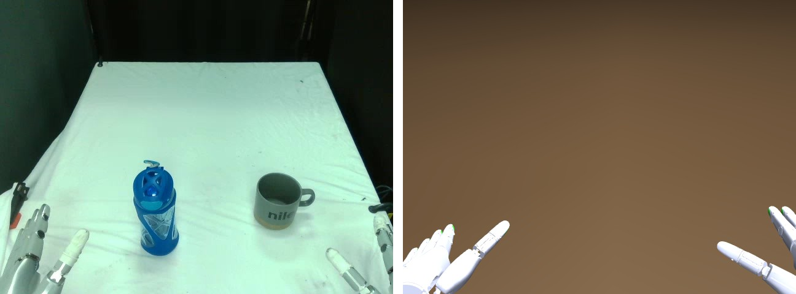
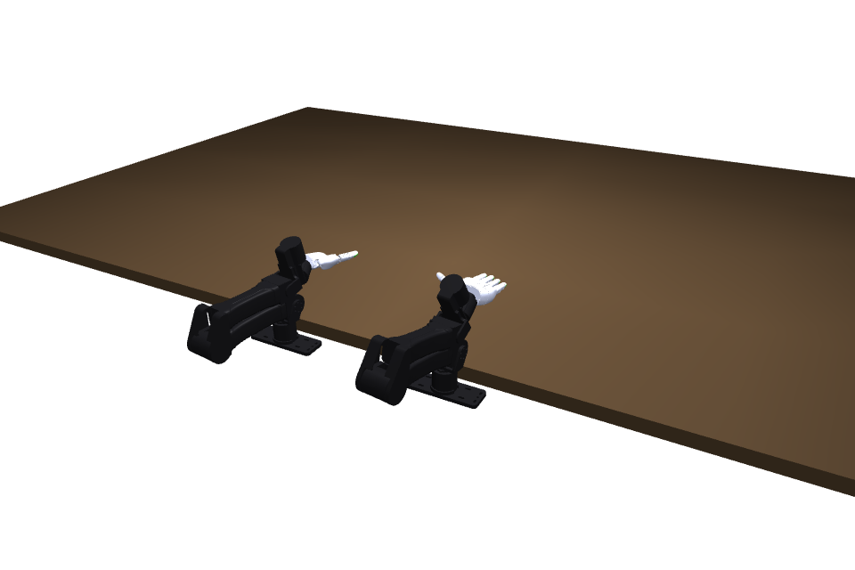

# Default setup: the DexAgent bench

The default robot setup is an I2RT YAM Box with two I2RT YAM arms (6 DOF each), each fitted with a Sharpa Wave dexterous hand (22 finger joints). The arms are mounted on the near edge of the table, and one fixed ego camera above the operator's position films the human demonstrations. This folder holds the calibrated simulation of that bench, which every stage starts from: the numbers are in `setup.yaml`, and the same bench is a MuJoCo scene in `scene.xml`.

Left: a photo from the ego camera during a session (the bottle and the mug are that session's objects). Right: `scene.xml` at its `home` keyframe rendered through the same camera.





## What is in it

| | |
|---|---|
| Frame | origin at the midpoint of the two mounts on the tabletop; x toward the right station, y into the work, z up; tabletop at z = 0 |
| Table | a slab whose top is z = 0 and whose near edge is 5 cm in front of the mounts; the visible cloth spans x −0.40…0.32, y 0.05…1.16 m |
| Stations | the two arm mounts at x = −0.23 and x = +0.26, 5 cm below the tabletop |
| Hand attachment | position-only weld: the arm carries the hand's position, the hand's six wrist joints hold its orientation |
| Home pose | keyframe `home`: both hands palm down at the bottom corners of the ego frame, fingers into the work (where the robot starts every episode; the demonstrators' resting hands sit about 10 cm inward and lower) |
| Ego camera | MuJoCo camera `ego`: 640×480, vertical field of view 38° (focal 697 px), 0.56 m above the tabletop, 0.18 m behind the mounts, pitched 33.7° down |
| Wrist cameras | `wrist_left`, `wrist_right`: 100° cameras rigid to each hand, the extra views Stage 4 renders |
| Physics | timestep 2 ms, `implicitfast` |

The numbers are in [`setup.yaml`](setup.yaml). The camera was calibrated from objects of known size in the footage; the station positions and the home pose were fitted to the robot hands in the first frame of the recordings. The arm's joints 2 and 3 have a lower limit of −0.15 rad instead of the vendor's 0, because the fitted home pose sits slightly below zero.

## Using it

The default run configuration points at this folder (`inputs.setup: setup` in [`../dexagent.yaml`](../dexagent.yaml)). Nothing else is needed. To look at it:

```bash
python setup/render_setup.py          # writes images/ego_home.png, wrist_*_home.png, overview_home.png
```

## Your own camera

If your demonstration was filmed by a different camera, keep this setup and give the camera in the run configuration (`camera:` in `dexagent.yaml`): width, height, vertical field of view or focal length, and the pose in this frame. If you do not know the pose, set `camera.source: estimate` and Stage 2 estimates it from the table plane in the video.

## Your own robot or bench

Copy this folder, replace the robot and edit the numbers, and point `inputs.setup` at the copy:

1. `scene.xml`: a MuJoCo scene with your table (top at z = 0) and your robots, with a keyframe `home` and a camera named `ego`. Each hand's root body is the end effector the pipeline steers; give it the name you write under `stations.<side>.hand_root_body`.
2. `setup.yaml`: the frame, the table, one entry per station (base body, arm joints, hand root body, wrist and finger joints, home pose), the cameras, and the physics options. Keep the keys; change the values and the names.
3. `python setup/render_setup.py my_setup/` and compare `images/ego_home.png` with a photo from your camera.

Every skill and verifier in the tool library takes the scene, the body names and the joint names as arguments, so a different arm, hand or station layout changes this folder only.

## Files

```
setup/
├── setup.yaml          the setup, machine-readable
├── scene.xml           the empty bench as MuJoCo MJCF
├── robot/              the hand and the arm on their own (see below)
├── assets/             robot meshes (see assets/LICENSES.md)
├── render_setup.py     renders images/ for this or any setup
└── images/             bench_photo_vs_sim.jpg, real_bench.jpg, ego_home.png, wrist_*_home.png, overview_home.png
```

## Robot files

`robot/sharpa_left.xml`, `robot/sharpa_right.xml` and `robot/yam_arm.xml` are the hand and the arm on their own, for tools that work with one hand and the objects (grasp synthesis, stress tests). In `scene.xml` each hand's root body sits at the world origin, so its six wrist joints (three slides, three hinges in intrinsic XYZ order) are the hand's world pose; a pose solved with the hand alone transfers to the bench unchanged.
